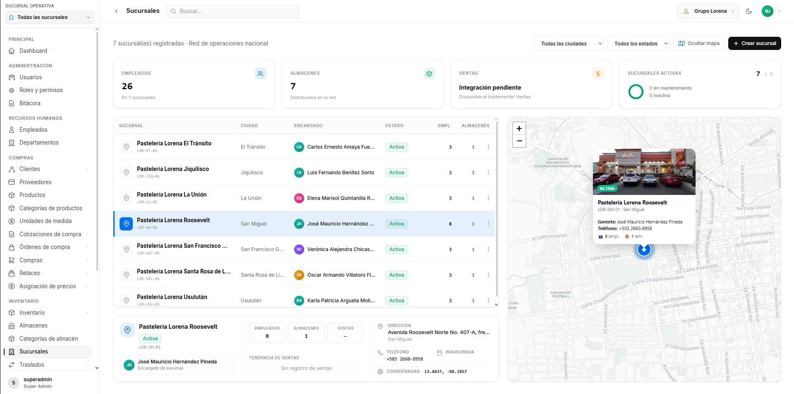
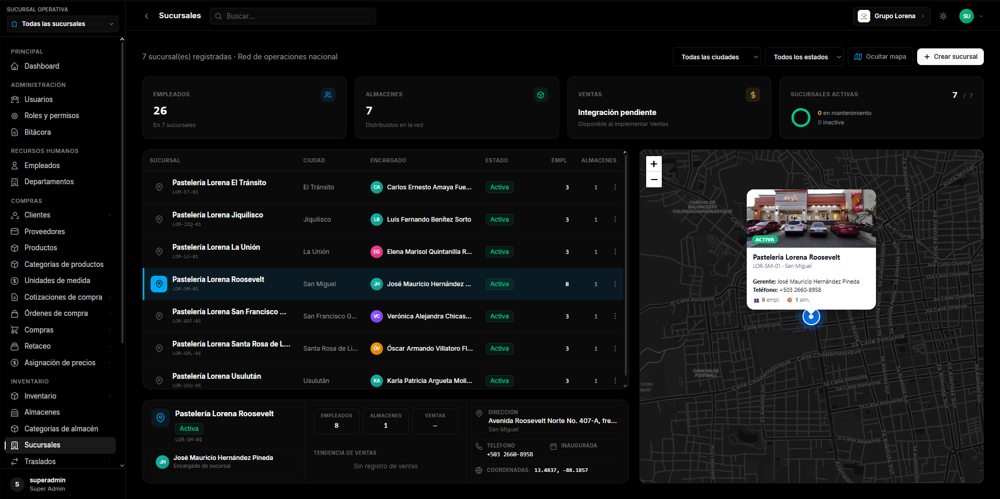
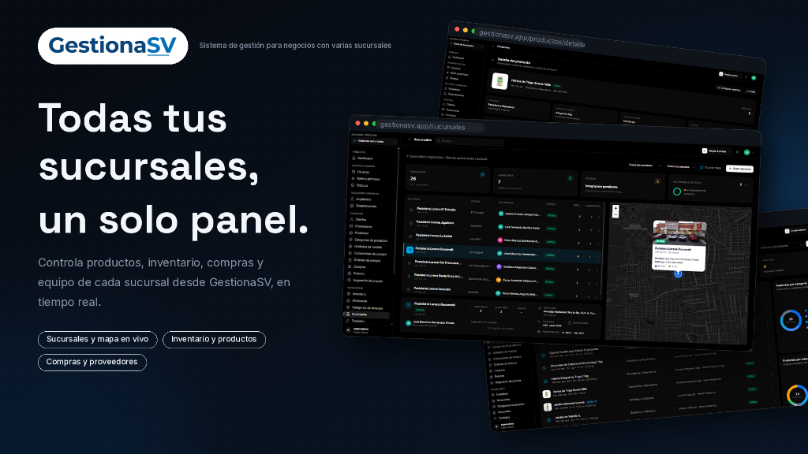

**GestionaSV** es un ERP multiempresa y multisucursal construido con
**FastAPI + SvelteKit 5 + PostgreSQL 16**. Cubre el ciclo completo de
abastecimiento de una cadena de tiendas: compras con retaceo de costos,
inventario por lotes y ubicaciones, traslados entre sucursales con flota propia
y seguimiento GPS, y el ciclo de venta con facturación electrónica (DTE),
cobros, devoluciones, libros de IVA y análisis comercial, además de la base
administrativa (usuarios, roles, bitácora, documentos y recursos humanos).

La empresa de demostración es **Grupo Lorena**, una cadena de panaderías de El
Salvador con siete sucursales.

| | |
|---|---|
| Módulos en operación | 48 de 49 entradas del menú |
| Migraciones de base de datos | 145 |
| Pruebas automatizadas | 2,117 de backend y 1,256 de frontend |
| Área más reciente | Ventas y facturación electrónica (DTE) |

---

## Vista Previa

| Modo Claro | Modo Oscuro |
| :---: | :---: |
|  |  |

<br>



---

## Stack

| Layer       | Technology |
|-------------|------------|
| Backend     | Python 3.12, FastAPI (async), SQLAlchemy 2.0 async, Alembic, Pydantic v2, asyncpg, structlog, Argon2id, PyJWT |
| Frontend    | SvelteKit (Svelte 5 runes), TypeScript strict, TailwindCSS, Vitest, design system Geist (Vercel) |
| Database    | PostgreSQL 16 |
| Infra       | Docker Compose v2, RustFS, ClamAV, Redis/ARQ, OCRmyPDF, Traccar (GPS), OpenTelemetry, Grafana, Prometheus, Loki, Tempo y Nginx |
| Opcional    | Lectura de licencias y tarjetas de circulación con un modelo de visión local (llama.cpp, requiere GPU NVIDIA) |
| Tooling     | `uv` (backend deps), `pnpm` (frontend deps), `make` |

---

## Quick start — un solo comando

Requisitos: **Docker** (con Compose v2), **Git** y **Bash**. En Windows, Bash viene con Git
for Windows; abre esa terminal, Git Bash, para estos comandos.

```bash
git clone <repo-url> erp-system && cd erp-system
make setup
```

O sin Make, con las mismas credenciales locales generadas:

```bash
git clone <repo-url> erp-system && cd erp-system
bash scripts/setup.sh
```

Docker Compose
espera las migraciones, ejecuta la semilla de primer setup y levanta el frontend
solamente cuando la base queda lista.

`make setup` hace todo automáticamente:

1. Copia `.env.example` → `.env`
2. Genera credenciales locales y levanta PostgreSQL, procesamiento documental, backend, frontend y observabilidad
3. Espera a que Postgres esté healthy
4. Ejecuta migraciones Alembic en una tarea separada antes de arrancar el backend
5. Siembra RBAC, superadministrador y el contexto operativo de Grupo Lorena
6. Verifica Grafana, Prometheus y Alertmanager y muestra sus URLs sin revelar contraseñas

La guía de métricas, trazas, logs, alertas, privacidad y operación está en
[`observability/README.md`](observability/README.md).

La semilla oficial crea una sola empresa: **Grupo Lorena**, con sucursales,
departamentos, empleados, usuarios operativos, categorías, almacenes y
ubicaciones. Tras completarse guarda un marcador en `app_meta`; los reinicios
posteriores la omiten para no resucitar registros eliminados intencionalmente.

Después, el mismo servicio `seed` ejecuta una sola vez cada paso complementario,
con su propio marcador (también en bases sembradas antes de que existiera):

| Paso | Marcador | Cuándo |
|------|----------|--------|
| Harina suave por saco de 50 lb (`PRD-HAR-001`: unidad de compra, venta e inventario = saco, sin conversión) | `seed.catalog.soft_flour_units` | Siempre; no cambia la unidad si el producto ya tiene documentos o movimientos |
| Flota (`seed_grupo_lorena_fleet`): vehículos, conductores y documentos de demostración (tarjeta de circulación, seguro, revisión técnica, licencia) | `seed.grupo_lorena.fleet` | Siempre. Si el almacenamiento o el antivirus no responden, asigna con excepción registrada y reintenta los documentos en el siguiente arranque |
| Operación de demostración (`seed_grupo_lorena_operations`): compras, recepciones, ubicación y traslados | `seed.grupo_lorena.operations` | Solo con `SEED_DEMO_OPERATIONS=true`, nunca con `ENVIRONMENT=production` |

Un paso complementario que falla se informa en el log y se reintenta en el
siguiente arranque; no detiene el stack. Cada seed también puede ejecutarse a
mano, de forma idempotente: `docker compose exec backend python -m
seed.seed_grupo_lorena_fleet` o `... -m seed.seed_grupo_lorena_operations`.
En producción el servicio no siembra (`compose.prod.yaml` fija `AUTO_SEED=false`
y `SEED_DEMO_OPERATIONS=false`; el despliegue automático no ejecuta seeds).

También registra el logo de la empresa y las galerías de sus siete sucursales
mediante un manifiesto versionado de 36 activos públicos de Cloudinary. La
semilla no contiene credenciales ni binarios: para visualizar las imágenes se
requiere conexión a Internet; las credenciales solo son necesarias para cargar
o eliminar medios desde la aplicación.

### URLs

| Servicio           | URL |
|-------------------|-----|
| Frontend (Svelte) | http://localhost:5173 |
| Backend (FastAPI) | http://localhost:8000 |
| Swagger docs      | http://localhost:8000/docs |
| ReDoc docs        | http://localhost:8000/redoc |
| RustFS console    | http://localhost:9001 |
| Redis             | 127.0.0.1:6379 (contraseña en `.env`) |
| Postgres          | localhost:5432 |

### Credenciales semilla

| Campo | Valor |
|-------|-------|
| Usuario | `superadmin` |
| Contraseña | valor de `SUPER_ADMIN_PASSWORD` en `.env` |

> **Cambiar antes de producción.** Ver `.env` para `JWT_SECRET_KEY` y `POSTGRES_PASSWORD`.

Los usuarios operativos de la semilla tienen contraseñas aleatorias no
recuperables. Un administrador debe asignarles una contraseña antes de usarlos.

### Funciones opcionales

No se instalan con `make setup`.

| Función | Cómo activarla | Qué necesita |
|---------|----------------|--------------|
| **GPS y Seguimiento** | `make setup-gps` (o `bash scripts/setup-gps.sh`) | Nada más: enciende el servidor GPS, crea su cuenta de servicio y detecta la IP de la PC |
| **Lectura de licencias** | `make setup-vlm` (o `bash scripts/setup-vlm.sh`); guía en [`ocr/README.md`](ocr/README.md) | GPU NVIDIA y descargar unos 3 GB una vez. Sin ella, los datos se escriben a mano |

Tras `make setup-gps`, conecta un equipo desde Flota > un vehículo > pestaña GPS. Para otra IP:
`GPS_HOST=192.168.1.50 make setup-gps`. La dirección solo sirve dentro de tu red; para llevarlo a
un servidor, ver [`docs/gps-produccion.md`](docs/gps-produccion.md).

---

## Comandos comunes

```bash
make up              # levantar stack
make down            # detener stack
make logs            # ver logs
make ps              # estado de contenedores
make test            # todos los tests (backend + frontend)
make test-backend    # tests backend
make test-frontend   # tests frontend
make seed            # ejecutar solo si el bootstrap todavía no fue completado
# FORCE_SEED=true make seed  # reconciliación explícita (puede restaurar canónicos)
# SEED_DEMO_OPERATIONS=true make seed  # además crea la operación de demostración
make reset-db        # wipe + migrar (destructivo)
make clean           # remover todo (contenedores, volúmenes, imágenes)
make storage-backup  # respaldar objetos y manifiesto con checksums
# make storage-restore BACKUP_DIR=<timestamp>
make lint            # lint backend + frontend
make prod-up         # levantar perfil producción (con Nginx)
```

---

## Estructura del proyecto

```
erp-system/
├── compose.yaml              # stack de desarrollo (db, backend, frontend, documentos, GPS, observabilidad)
├── compose.prod.yaml         # prod overlay (+ Nginx, non-root)
├── Makefile                  # targets: up/down/test/seed/reset-db/clean
├── .env.example              # template de variables de entorno
├── scripts/
│   ├── setup.sh              # un solo comando: build + migrate + seed
│   ├── seed.sh               # sembrar base de datos
│   ├── reset-db.sh           # wipe + migrar
│   └── run-tests.sh          # runner unificado de tests
├── docs/                     # arquitectura, schema DB, RBAC, API, design system y manuales (ers-v1/)
├── observability/            # Grafana, Prometheus, Loki, Tempo y alertas
├── object-storage/ antivirus/ redis/ ocr/   # servicios del flujo documental
├── backend/                  # FastAPI (Clean / Hexagonal)
│   ├── Dockerfile            # multi-stage (dev + prod)
│   ├── pyproject.toml        # deps pinned, ruff, pytest, mypy
│   ├── alembic/              # migraciones versionadas (async)
│   ├── app/
│   │   ├── main.py           # app factory + lifespan (migraciones on startup)
│   │   ├── core/             # config, security, logging, exceptions
│   │   ├── domain/           # entidades + puertos (sin deps de framework)
│   │   ├── application/      # casos de uso por módulo (compras, inventario, traslados, flota…)
│   │   ├── infrastructure/   # DB engine, ORM models, repos concretos
│   │   ├── api/v1/           # routers + DTOs + deps + exception handlers
│   │   └── middlewares/      # security headers, request context, rate limit
│   ├── seed/                 # seed de permisos, roles, super-admin, demo
│   └── tests/                # unit (fakes) + integration + e2e (DB real)
├── frontend/                 # SvelteKit 5 (feature-sliced, Geist design)
│   ├── Dockerfile            # multi-stage (dev + prod, adapter-node)
│   ├── package.json          # pnpm, Svelte 5, Tailwind, Vitest
│   ├── src/
│   │   ├── app.html          # no-FOUC theme script
│   │   ├── app.css           # tokens Geist (claro/oscuro) + utilidades
│   │   ├── routes/           # una carpeta por módulo del menú
│   │   └── lib/
│   │       ├── api/          # cliente con interceptor refresh
│   │       ├── components/ui/  # Button, Card, Modal, Badge, Avatar, Sidebar
│   │       ├── features/dashboard/  # KpiCard, AreaChart, DonutChart, etc.
│   │       ├── stores/       # session, theme, permissions, search
│   │       └── navigation.ts # menú lateral (48 módulos en operación + 1 pendiente)
│   └── tests/                # vitest + testing-library
└── nginx/                    # reverse proxy para prod
```

---

## Seguridad

- Argon2id para contraseñas (configurable via env)
- JWT access (15 min) + refresh rotation con detección de reuso
- Rate limiting: login 10/min, refresh 30/min por IP
- Bloqueo progresivo tras 5 intentos fallidos
- `require_permission("code")` en cada endpoint sensible (deny-by-default)
- Cabeceras OWASP: CSP, X-Frame-Options, HSTS (prod), Referrer-Policy
- CORS restrictivo (nunca `*` con credenciales)
- Bitácora append-only (sin endpoints de UPDATE/DELETE)
- Ver `docs/architecture.md` para el mapeo OWASP A01-A10 completo
- Ver `object-storage/README.md` para RustFS, persistencia y respaldos
- Ver `antivirus/README.md` para ClamAV, límites y diagnóstico
- Ver `redis/README.md` y `ocr/README.md` para la cola y el procesamiento buscable
- Ver `docs/document-storage.md` para el flujo documental completo

---

## Testing

```bash
make test              # todos los tests (backend + frontend)
make test-backend      # pytest con coverage
make test-frontend     # vitest
```

Última validación completa en integración continua, sobre `develop`, el
14 de noviembre de 2026:

- **Backend**: 1,723 pruebas aprobadas y 2 omitidas intencionalmente.
- **Frontend**: 1,104 pruebas aprobadas en 173 archivos.
- **svelte-check**: 0 errores y 7 advertencias.
- **ESLint, Ruff y mypy**: OK.
- **Build de producción**: OK.

Cada cambio entra por pull request hacia `develop` y debe pasar dos flujos de
GitHub Actions: `ERP quality gate` (pruebas, lint, tipos y build) y
`Security gate` (análisis de imágenes y dependencias).

- **Unit**: casos de uso con repositorios in-memory (sin DB)
- **Integration**: repositorios contra Postgres real
- **E2e**: flujos completos via httpx contra la app FastAPI
- Cobertura objetivo: ≥80% en `application/` y `domain/`

---

## Módulos

### Administración y recursos humanos

| Módulo | Estado |
|--------|--------|
| Autenticación | ✅ Login, JWT con rotación de refresh, bloqueo progresivo |
| Usuarios | ✅ CRUD, filtros y alcance por empresa y sucursal |
| Roles y permisos | ✅ RBAC dinámico con matriz administrable |
| Bitácora | ✅ Append-only con paginación |
| Documentos | ✅ Biblioteca, cargas, RustFS, ClamAV, OCR y expedientes |
| Empleados y departamentos | ✅ CRUD, jerarquía y expediente documental |
| Papelera | ✅ Ciclo de vida y restauración transversal |
| Dashboard | ✅ Indicadores y gráficos |

### Compras

| Módulo | Estado |
|--------|--------|
| Proveedores | ✅ Contactos, imágenes, identificadores fiscales y datos maestros |
| Productos, categorías y unidades | ✅ Catálogo, presentaciones, variantes e identificadores |
| Solicitudes de compra | ✅ Creación, aprobación y consolidación por sucursal |
| Cotizaciones de compra | ✅ Evaluación, comparación y selección |
| Órdenes de compra | ✅ Aprobación, envío y documentos de gastos |
| Compras | ✅ Recepción total o parcial, verificación y conversión de monedas |
| Tipos de gasto | ✅ Catálogo por empresa |
| Retaceo | ✅ Distribución de costos proporcional o por montos fijos, con reportes |

### Inventario

| Módulo | Estado |
|--------|--------|
| Inventario | ✅ Lotes, etiquetas, unidades logísticas, colocación y fraccionamiento |
| Kardex | ✅ Movimientos por producto, lote y ubicación, con conciliación |
| Valoración de inventario | ✅ Costo promedio con libro inmutable |
| Ajustes de inventario | ✅ Entradas y bajas con motivo, evidencia y aprobación |
| Almacenes y categorías | ✅ Estructuras, ubicaciones, capacidad y generador de ubicaciones |
| Sucursales | ✅ Perfiles, galería y mapa |
| Traslados | ✅ Preparación, aprobación, despacho, recepción parcial y discrepancias (faltante, sobrante, avería) |
| Reglas de traslados | ✅ Rutas entre bodegas y quién aprueba |

### Logística

| Módulo | Estado |
|--------|--------|
| Flota | ✅ Vehículos, documentos, mantenimiento, inspecciones y disponibilidad |
| Tipos de vehículo, puntos de inspección y reglas | ✅ Catálogos y reglas de aptitud para despacho |
| Costos de flota | ✅ Registro y análisis por vehículo |
| Conductores | ✅ Licencias, documentos y viajes |
| Seguimiento | ✅ GPS en tiempo real con Traccar y recorrido archivado por traslado |
| Captura de documentos | ✅ Lectura asistida de licencias y tarjetas de circulación (opcional, con GPU) |

### Ventas

| Módulo | Estado |
|--------|--------|
| Clientes | ✅ Contribuyente o consumidor final, crédito, lista de precios y consentimiento de datos |
| Listas de precios, topes de descuento y promociones | ✅ Vigencias, margen sobre costo, autorización y promoción por sucursal |
| Cotizaciones y pedidos | ✅ Cálculo fiscal en el servidor, nunca bajo costo, salida de bodega al confirmar |
| Facturación electrónica (DTE) | ✅ Multiemisor: factura, crédito fiscal, notas, remisión y retorno; contingencia e invalidación |
| Cuentas por cobrar | ✅ Recibos, saldo a favor, retención, límite de crédito, mora y gestión de cobro |
| Devoluciones | ✅ Nota de crédito o retorno automático, reintegro y cambio de producto |
| Libros de IVA | ✅ Contribuyentes, consumidor final y compras; anexos del F-07 y cierre del mes |
| Análisis comercial | ✅ Venta, margen, devoluciones y metas por sucursal, con permiso |
| Punto de venta y caja | 🔜 Pospuesto |

### Pendientes en el menú

| Módulo | Estado |
|--------|--------|
| Configuración | Pendiente |

---

## Despliegue

Cada cambio integrado en `develop` dispara el flujo `deploy.yml`, que entra por
SSH al servidor y ejecuta `scripts/deploy.sh`: actualiza el código, aplica las
migraciones y reinicia los servicios. El perfil de producción
(`compose.prod.yaml`) agrega Nginx, ejecuta los contenedores sin privilegios y
no siembra datos.

---

## Hoja de ruta

El área de Ventas quedó completa en la v2.1.0. Lo siguiente:

1. Punto de venta y caja: venta de mostrador, turnos, arqueo y existencia de
   vitrina (pospuesto; detalle en `PLAN.md`).
2. Módulo de Configuración.
3. Certificación de la facturación electrónica con Hacienda.

---

## Documentación

- `object-storage/README.md` — configuración y operación local de RustFS
- `antivirus/README.md` — configuración y operación de ClamAV
- `redis/README.md` — persistencia y operación de Redis/ARQ
- `ocr/README.md` — flujo y operación del worker OCRmyPDF
- `docs/architecture.md` — capas, ADRs, OWASP
- `docs/database-schema.md` — diagrama ER (Mermaid)
- `docs/rbac-model.md` — motor de permisos
- `docs/api.md` — endpoints y convenciones
- `docs/design-system.md` — tokens Geist
- `docs/security-and-audit.md` — guía de seguridad y auditoría
- `docs/red-team-blue-team.md` — arquitectura Red Team / Blue Team, escáneres ZAP/Trivy, Git Hooks y notificaciones
- `docs/module-creation-guide.md` — guía paso a paso para la creación de nuevos módulos
- `docs/testing-strategy.md` — estrategia de testing (Pytest + Vitest)
- `docs/troubleshooting-faq.md` — resolución de problemas y FAQ
- `docs/ers-v1/guia-maestra.md` — guía maestra de compras e inventario
- `docs/ers-v1/manual-ventas.md` — ciclo completo de Ventas y facturación electrónica, permisos y recorrido de demostración
- `docs/ers-v1/manual-traslados.md`, `manual-ajustes.md`, `manual-entregas.md` y `manual-ventas-base.md` — manuales de operación
- `docs/ers-v1/manual-pruebas-y-demostracion.md` — recorrido de pruebas y demostración
- `docs/flujo-compras-inventario-retaceo.md` — flujo de compras, inventario y retaceo
- `docs/warehouse-capacity-operations.md` — capacidad y ubicaciones de almacenes
- `docs/gps-produccion.md` — puesta en producción del seguimiento GPS
- `observability/README.md` — métricas, trazas, logs y alertas

---

## Licencia

Propietario — uso interno.
