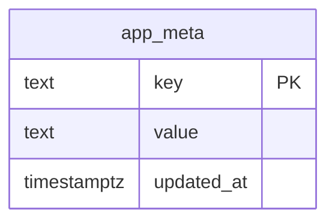
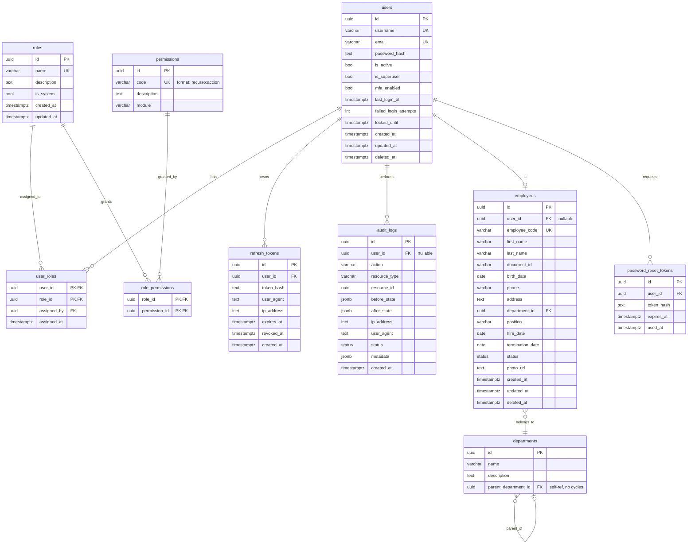

# Database Schema

## Product families and variants (0037)

The catalog keeps the current product as the family parent. `products.variant_mode`
is `standalone` for regular products and becomes `template` when the first
variant is created. Family attributes and allowed values live in
`product_family_attributes` and `product_family_attribute_values`; variants,
their canonical combinations and lifecycle are stored in `product_variants`.
`product_variant_attribute_values` enforces one value per attribute. A variant
may have one primary image in `product_variant_images`.

`product_sku_registry` reserves SKUs across products and variants within a
company. `product_identifiers` now targets exactly one product or variant, so
EAN/UPC/GTIN uniqueness cannot be bypassed by moving between tables. Existing
products are not backfilled into families. The migration is fail-closed on
downgrade when variant data exists.

Variants are catalog identity only in this revision. Inventory, purchasing,
sales, pricing, lot and serial tables must reference `variant_id` only when
those bounded contexts are implemented.

> **Versión:** `v1.0.0` | **Última actualización:** `19/10/2026`
> Complete schema design and conventions for PostgreSQL 16.

## 1. Conventions

- **Primary keys:** `UUID` (server-side `gen_random_uuid()`). No int autoincrement.
- **Timestamps:** `TIMESTAMPTZ` everywhere. `created_at` and `updated_at` on every
  entity; `deleted_at` for soft-delete on business entities.
- **Soft delete:** `users`, `employees`, `departments` use `deleted_at`. Hard
  delete is reserved for junction rows where history is captured elsewhere.
- **Naming:** snake_case tables and columns; constraints get stable names via
  Alembic autogenerate + manual review.
- **Audit log:** append-only (`INSERT` only); no `UPDATE`/`DELETE` API surface.

## 2. Phase 0 — current schema (Mermaid)



`app_meta` holds key/value markers (e.g. `schema_phase = 0`) and exists so
migrations are wired end-to-end and verifiable.

## 3.1 Explicit headquarters and company central warehouse (0084)

`branches.is_headquarters` identifies the company's administrative receiving
and distribution branch. A partial unique index
`uq_branches_company_active_headquarters` allows at most one active matrix per
company. The matrix may reuse the company's registered address and geography;
its coordinates can remain `NULL` because an administrative address does not
establish a physical warehouse location.

Every warehouse has an assigned branch after migration 0084. The former
company-level central warehouse keeps its existing `id`, location rows, stock,
handling units, movements and document references; only its `branch_id` is
associated with the company's matrix. `uq_warehouses_company_active_central`
retains one active central warehouse per company without inferring its role from
a missing branch. A database trigger rejects a central warehouse assigned to
another company's branch or a non-active/non-matrix branch and prevents
deactivating its matrix while the link remains.

Alembic 0084 preflights duplicate active central warehouses, unresolved
unassigned non-central warehouses and required company address/geography before
writing. It logs a company-to-matrix-to-central-warehouse map in the migration
log. DDL and row mapping execute transactionally. Downgrade restores the prior
branchless representation for central warehouses and removes the explicit
marker; it deliberately preserves any generated administrative branch so
organization data is not deleted. The read-only
`backend/scripts/preview_headquarters_migration.py` prints the proposed mapping
only after confirming the exact database name supplied by the operator.

## 3. Target schema (Phases 1–4)



## 4. Indexes (target)

| Table | Column(s) | Type |
|-------|-----------|------|
| `users` | `email` | unique, btree |
| `users` | `username` | unique, btree |
| `employees` | `employee_code` | unique, btree |
| `audit_logs` | `created_at` | btree (DESC, for cursor pagination) |
| `audit_logs` | `user_id` | btree |
| `audit_logs` | `(resource_type, resource_id)` | composite btree |
| `refresh_tokens` | `token_hash` | unique, btree |
| `refresh_tokens` | `(user_id, revoked_at)` | partial where `revoked_at IS NULL` |

## 5. Migration policy

- One Alembic revision per logical change. Revisions are reversible
  (`downgrade()` implemented and tested).
- `compare_type` and `compare_server_default` are enabled so autogenerate
  catches type drift.
- Migrations are an explicit one-shot deployment step (see ADR-003 in
  `architecture.md`). The API startup hook remains opt-in for disposable
  environments only; ordinary development and production set
  `RUN_MIGRATIONS_ON_STARTUP=false`.
- `create_all()` is **dev/test only**; production always uses Alembic.

## 6. Warehouse location integrity (revision 0030)

Revision `0030` makes two application invariants enforceable by PostgreSQL:

- `code_scheme_id` and `scheme_version` are either both null (legacy code) or
  both present, in both `locations` and `location_code_aliases`. The existing
  composite foreign keys then validate the exact warehouse-scoped scheme
  version.
- A location is retired if and only if `is_active` is false. Every non-retired
  lifecycle state (`draft`, `active`, blocked variants, or `maintenance`) stays
  active in the persistence model.

The migration runs read-only preflight checks before creating constraints and
aborts without repairing data when it finds an inconsistent row. Operators
must resolve those rows deliberately, rerun the preflight, and only then
promote the migration. Its downgrade drops only the three checks and does not
rewrite business data or permissions.

## 7. Product image galleries (revision 0031)

Revision `0031` adds the normalized `product_images` table. Each product can
have up to 20 ordered images and exactly one cover when the gallery is
non-empty. Cloudinary images reference a staged/active `media_assets` row owned
by the same company; external images are stored as HTTPS references only. The
backend never fetches external image URLs.

The gallery stores `source_type`, URL, optional accessible `alt_text`,
zero-based `position`, and `is_cover`. Product list responses project only
`cover_image` and `image_count`; individual product responses include the
complete ordered gallery. Removed Cloudinary assets are marked `detached` for
the existing cleanup process.

## 8. Supplier and supplier-contact primary images (revision 0032)

Revision `0032` adds one normalized primary image relation for each supplier
and supplier contact. `supplier_images` stores the supplier logo and
`supplier_contact_images` stores the contact avatar. Both tables validate
Cloudinary/external source parity, enforce one relation per owner, and retain
accessible alternative text without storing binary content. Existing supplier
contacts receive a persistent UUID so staged Cloudinary assets can be claimed
with the same owner isolation used by other media flows.

External images are HTTPS references rendered directly by the browser; the API
never downloads or probes those URLs. Cloudinary assets must be staged/active,
belong to the current company, and have the purpose matching the relation.
Removed assets are marked `detached` for the existing cleanup process.

## 9. International supplier master data (revision 0033)

`suppliers.name` remains the commercial name and `suppliers.address` remains a
legacy compatibility field. Revision `0033` adds optional legal identity,
company-scoped supplier groups, workflow status/hold dates, currency, payment
terms, payment method and an external reference. Existing suppliers are
backfilled only to `supplier_status = approved`; no tax or legal values are
invented.

Fiscal identifiers live in `supplier_tax_identifiers` and are generic
(`country_id`, `identifier_type`, `value`) so an El Salvador supplier may use
NIT/NRC while an international supplier may use VAT, EIN, RFC or any local
identifier. They are optional, repeatable and normalized for duplicate
detection; only one may be primary per country.

`supplier_groups`, `currencies`, `payment_terms` and `supplier_addresses` are
normalized catalogues/relations. Existing non-empty legacy addresses are copied
to one primary `other` address without deleting the original column.

`supplier_bank_accounts` stores only AES-GCM ciphertext and the last four
digits. The encryption key is supplied by `SUPPLIER_DATA_ENCRYPTION_KEY` from
the deployment secret manager; APIs never return or audit full account numbers,
IBANs, ciphertext or keys. The 0033 downgrade refuses to run while supplier
master data, addresses, banking records or custom catalog rows exist.

## 10. Product measurements (revision 0034)

Revision `0034` normalizes physical product measurements without changing the
commercial `units` catalogue used by purchase and sale units. Products now
store optional `dimension_length`, `dimension_width`, `dimension_height`,
`dimension_unit`, `weight` and `weight_unit` values. Dimension units are the
fixed codes `mm`, `cm`, `m`, `in` and `ft`; weight units are `mg`, `g`, `kg`,
`t`, `oz` and `lb`. PostgreSQL checks reject negative values, unsupported
codes, and measurements without their paired unit.

The former free-text `dimensions` column remains for API compatibility. During
the migration, unambiguous strings such as `20 x 30 x 10 cm` are backfilled
into structured columns; ambiguous values remain in `dimensions_legacy` and
are never discarded. New writes use only structured fields. Volume is derived
at read time in cubic metres from all three dimensions and is never stored as
a user-editable value.

## 11. Product-domain transactional boundaries

Inventory identity, versioned packaging conversions, lightweight handling units,
lots, expiry, movements, balances and capacity reservations are implemented by
revision `0040`.

The purchasing document flow and the current Retaceo landed-cost allocation are
also implemented, but remain separate transactional capabilities from the
physical-capacity model. Price history, replenishment policies, serial tracking
and broader regulatory compatibility remain separate concerns.

### Purchasing flow migrations

The implemented purchasing and Retaceo flow is represented by these Alembic
revisions:

- `0044_purchase_requests.py`
- `0045_reconcile_purchase_request_permissions.py`
- `0048_purchase_quotations.py`
- `0049_reconcile_purchase_quotation_permissions.py`
- `0050_purchase_orders.py`
- `0051_reconcile_purchase_order_permissions.py`
- `0052_purchase_order_expense_documents.py`
- `0053_purchase_order_detail_traceability.py`
- `0054_purchases.py`
- `0055_reconcile_purchase_permissions.py`
- `0056_retaceos.py`
- `0057_purchase_receipt_inventory_link.py`
- `0058_expense_type_management.py`
- `0059_inventory_packaging_purchase_unit.py`
- `0060_retaceo_itemized_costs.py`
- `0061_retaceo_cost_document_soft_delete.py`
- `0062_purchase_demand_consolidations.py`
- `0063_purchase_request_create_permission.py`
- `0064_purchase_consolidation_event_uuid_default.py`
- `0065_purchase_quotation_rfq_versions.py`
- `0066_purchase_quotation_documents.py`
- `0067_purchase_consolidation_awards.py`
- `0068_purchase_quotation_document_detach.py`
- `0069_purchase_order_consolidation_award_link.py`
- `0070_purchase_consolidation_branch_demand_level.py`
- `0071_branch_product_demand_levels.py`
- `0072_central_warehouse_designation.py`
- `0073_company_level_mother_warehouse.py`
- `0074_branchless_central_purchases.py`
- `0075_transfer_handling_unit_splits.py`
- `0076_purchase_consolidation_close.py`
- `0077_purchase_consolidation_quotation_outcomes.py`
- `0078_inventory_movement_actor_history.py`
- `0079_inventory_valuation.py`
- `0080_inventory_receipt_lots.py`
- `0081_inventory_label_prints.py`
- `0082_inventory_trace_capabilities.py`
- `0083_inventory_label_confirmation_and_receipt_origin.py`
- `0084_explicit_headquarters_branch.py`
- `0085_receipt_detail_lot_identity.py`

### Purchasing flow tables

The main tables introduced for the purchasing and Retaceo flow are:

- `purchase_requests`
- `purchase_request_details`
- `purchase_quotations`
- `purchase_quotation_requests`
- `purchase_quotation_request_details`
- `purchase_quotation_details`
- `purchase_quotation_line_snapshots`
- `purchase_quotation_documents`
  - `deleted_at` registra cuándo se desvinculó un archivo sin borrar la evidencia de auditoría.
- `purchase_quotation_expenses`
- `purchase_consolidations`
- `purchase_consolidation_lines`
- `purchase_consolidation_sources`
- `purchase_consolidation_events`
- `expense_types`
- `purchase_orders`
- `purchase_order_details`
- `purchase_order_expenses`
- `purchase_order_expense_documents`
- `purchases`
- `purchase_details`
- `retaceos`
- `retaceo_details`

### Purchasing line traceability

The purchasing flow preserves exact line-level traceability across each
transactional stage:

```text
Purchase Request Detail
    -> Purchase Quotation Request Detail
    -> Purchase Quotation Detail
    -> Purchase Order Detail
    -> Purchase Detail
    -> Retaceo Detail
```

The persisted references that maintain this chain are:

- `purchase_quotation_request_details.purchase_request_detail_id`
- `purchase_quotation_request_details.purchase_quotation_detail_id`
- `purchase_order_details.purchase_quotation_detail_id`
- `purchase_details.purchase_order_detail_id`
- `retaceo_details.purchase_detail_id`

These foreign-key relationships preserve company-scoped ownership and prevent
the transactional documents from losing the exact source line that originated
each downstream detail.

Revision `0065` links supplier RFQs to a purchase consolidation and stores a
version number per supplier. `purchase_quotation_details.offered_quantity`
holds the supplier's offer separately from the immutable requested quantity.
`purchase_quotation_line_snapshots` preserves the copied product labels,
branch/central quantities and source-request breakdown for each RFQ version.
Revision `0066` links company-scoped, security-scanned document assets to a
purchase quotation so the original supplier offer can be retained and downloaded
without storing file contents in the purchasing tables.

## 13. Physical capacity and inventory (revisions 0039–0040)

Revision `0039` removes ambiguous pallet/generic capacity from the forward
schema. Warehouses and storage locations store certified and operational limits
for kilograms and usable cubic metres, a capacity profile, enforcement mode,
storage eligibility and optional usable dimensions. Structural groups represent
shared rack, bay, level, floor or cold-room constraints; location maximums are
not summed to infer structural strength.

Revision `0040` adds inventory identities for standalone products or variants,
versioned packaging definitions, non-nested handling units, immutable movement
headers and lines, materialised balances, expiring capacity reservations and
temporary operational overrides. Movement lines preserve packaging and physical
measurement snapshots so later master-data changes do not rewrite history.

Capacity uses canonical units and computes `projected = occupied + reserved` at
the location, warehouse and applicable structural groups. PostgreSQL constraints
enforce positive limits, operational-at-or-below-certified boundaries, valid
state catalogues and composite item/override references. Company ownership of
locations is resolved through warehouse and branch and is also checked by every
inventory application command. Unknown measurements remain
explicit; they do not contribute a fabricated zero and normal receipt is blocked
until the stock is measured or placed in controlled quarantine.

## 14. Document storage and OCR (revisions 0041–0042)

`document_assets` stores tenant-scoped metadata for immutable private objects. It records the
normalized display name, declared and detected MIME, size, SHA-256, private bucket/key, ETag,
scan state and audited soft-delete fields. The supported states are `pending_upload`,
`pending_scan`, `scanning`, `active`, `quarantined` and `rejected`; only `active` is downloadable.
The unique `(bucket, object_key)` constraint and company/status/date indexes support safe lookup,
maintenance and retention without exposing storage coordinates through the API.

`document_derivatives` records immutable generated objects without changing the canonical
document. Revision `0042` initially supports one `ocr_pdf` per document with states `pending`,
`processing`, `ready`, `failed` and `skipped`; it stores size, SHA-256, ETag, attempts, failure
code and processing timestamps. The unique `(document_id, kind)` constraint makes creation
idempotent, while company/status/date indexes support tenant isolation, reconciliation and stale
job recovery. PostgreSQL—not Redis—is the durable source of processing state.

## 12. Product master enrichment (revisions 0035–0036)

Revisions `0035` and `0036` extend the product master without embedding
transactional inventory or purchasing balances in the catalogue row. Products now have an explicit kind
(`goods` or `service`), lifecycle (`draft`, `active`, `blocked`,
`discontinued`, `retired`), purchase/sale flags, commercial and internal names,
separate descriptions, keywords, origin country, company-scoped brand and
manufacturer references, and physical storage/handling rules. `is_active` is
kept for compatibility and is constrained to match the lifecycle.

`product_brands` and `product_manufacturers` are company-scoped catalogs with
composite tenant-safe foreign keys. Physical storage fields are only valid for
goods; temperature is expressed in Celsius and ranges are checked in the
database.

`product_identifiers` stores optional EAN/UPC/GTIN/ISBN, manufacturer, internal
and generic identifiers. Values are normalized for uniqueness, and only one
primary identifier is allowed per product/type. `product_suppliers` stores the
current sourcing relationship (cost, currency, MOQ, multiple, lead time,
preferred flag and validity), with company-composite foreign keys, one active
preferred supplier per product and constraints for approved suppliers. Price
history, purchasing documents and inventory conversions remain deferred.

## 15. Consolidated purchase awards (revision 0067)

`purchase_consolidation_awards` stores each manual allocation from one
consolidation product line to a specific supplier quotation detail. Quantity,
actor and required reason are decision data; reversals set the reversal
timestamp, actor and reason rather than deleting the award. Composite foreign
keys keep the consolidation, line, quote, quote detail and supplier in the same
company. The line/active and quote-detail/active indexes support remaining
demand calculations. Consolidation event history records both award and
reversal actions. Aggregate limits (not exceeding remaining demand or offer)
are checked transactionally while the consolidation header is locked.

## 16. Receipt lots, label prints and public trace links (revisions 0080–0082)

Revision `0080` adds `inventory_lots` and `inventory_lot_details`, linking each
verified purchase receipt to accepted quantities by inventory item. Handling
units reference the receipt lot; their inventory item and base quantity are
matched to its accepted details when placement and trace data are assembled.

Revision `0081` adds append-only `inventory_label_prints`. It records the
company, receipt lot/detail or handling unit, idempotency key, print count and
date, initial/reprint reason, actor, and a snapshot of the printed label. It
does not change inventory balances.

Revision `0082` adds `inventory_trace_capabilities`, a company-scoped,
revocable bearer link for public read-only traceability of one handling unit.
Only a unique SHA-256 token digest is persisted; the plaintext token is
returned at issuance and placed in the QR URL fragment. The capability has
created/revoked actor references, timestamp fields, and a composite foreign key
to the unit in the same company. The public response is an API allowlist, not a
direct serialization of the internal trace model.

## 17. Canonical receipt-detail identity (revision 0085)

`inventory_lot_details.code` is the stable lot identity for one product line
accepted on one purchase receipt. The code is derived from the existing receipt
header code and immutable detail UUID; it is unique within a company. Separate
details, including separate partial receipts for the same product, retain
different codes and their original `purchase_detail_id`.

`inventory_movement_lines.inventory_lot_detail_id` is a nullable,
company-composite FK for new physical movements. The column remains nullable so
pre-0085 immutable ledger rows are not rewritten. Read models can resolve those
older rows through the exact handling unit's `inventory_lot_detail_id`; rows
without that evidence remain unlinked legacy history. This is a read-time
compatibility mapping, not a second editable stock balance. `inventory_lots`
remains the receipt header and its prior code is a search alias that can resolve
to several detail codes.

The 0085 migration adds identity and relationship schema only. It does not
create label-print or label-confirmation events and does not change receipt
quantities, handling units, balances, movement entries or valuation. The ERS
mapping is functional; the existing physical schema does not claim that every
teaching-diagram table is implemented under the same name.

## 18. Transfer documents and mobile vehicle stock (revision 0086)

Revision `0086` adds one technical transit warehouse per company and marks it
`is_transit`; its `vehicle` locations are bound to company-scoped rows in
`inventory_vehicles`. Technical transit warehouses are excluded from ordinary
storage eligibility and shelf-capacity calculations but remain in global
physical reconciliation and company/product valuation.

`inventory_transfers` is the document header. `inventory_transfer_details`
records the product, canonical receipt-detail lot, source handling unit,
planned/dispatched/received/returned quantities and any manual-excess reason.
`inventory_transfer_demand_allocations` links a line to a purchase-request
detail without creating a second stock reservation. `inventory_transfer_commands`
stores action-scoped idempotency keys and response snapshots. Each partial
receipt is separately recorded in `inventory_transfer_receipts`, linked to its
command, movement and resulting destination handling unit. Open/resolved
incidents and their reason/evidence/resolution are retained in
`inventory_transfer_incidents`.

Company-composite foreign keys and transactional quantity checks protect
cross-company references and prevent received/returned quantity from exceeding
dispatch. Dispatch and receipt invoke existing inventory movements; they do not
edit historic entries or create a second valuation balance. Revision `0086`
does not backfill old generic transfer movements into documents or invent
vehicles for legacy stock. No transfer return command is exposed in this block;
the returned-quantity field is reserved for a later explicitly authorized
return path.

## 19. Authorized inventory adjustments and transfer losses (revision 0087)

`inventory_adjustments` stores the company-scoped document code, warehouse,
operational/accounting dates, reason, document reference, lifecycle/version,
correction link, optional transfer/incident link, actors, idempotency data and
application snapshot. Its lifecycle is `draft`, `approved`, `applied` or
`cancelled`; the approved version must equal the current version. Company-safe
foreign keys bind the warehouse, correction origin, transfer, incident and
actors.

`inventory_adjustment_details` stores ordered lines with item, warehouse,
location, stock status, direction, positive base quantity, optional canonical
receipt-detail lot/handling unit/packaging, documented cost, physical measures,
transfer detail and movement references. Compound foreign keys prevent using
another company's item, lot, location, unit, transfer detail or movement.
Positive lines can only enter quarantine and record either documented unit or
total cost. Negative lines must identify an existing handling unit and cannot
inject a cost.

`inventory_adjustment_documents` pins the file asset ID, company, SHA-256,
filename, linker and timestamps. Detaching a draft support is a timestamped
event in the row; the file itself is not deleted. `inventory_adjustment_events`
is append-only and records actor, action, time, reason and document version.
Database triggers prevent updates/deletes of applied headers/details and event
mutation, and prevent deleting or changing a file asset linked to an approved
or applied adjustment.

Revision `0087` adds `quantity_adjusted_out` (default zero) to
`inventory_transfer_details` and `inventory_transfer_demand_allocations`, and
extends their checks so received, returned and adjusted-out quantities cannot
exceed dispatched/allocated quantities. Transfer state `closed_with_adjustment`
and the idempotent `resolve_adjustment` command distinguish a documented loss
from an actual receipt. Existing rows start at zero; revision `0087` does not
rewrite legacy movements or cost averages.

## 20. Sales base without delivery (revision 0088)

Revision `0088` adds six company-scoped tables for the commercial flow:

- `sales_customers` stores code, name, optional phone/email, active flag and
  creator/updater. A case-insensitive unique index enforces customer code per
  company. Deactivation retains the row and existing documents.
- `sales_quotations` stores branch, customer, code, quotation/validity dates,
  USD currency, server-calculated totals, lifecycle/version, notes and
  confirmation/cancellation actors and timestamps. Composite foreign keys
  bind company, branch, customer and users. Checks constrain status,
  dates/version, totals and transition metadata.
- `sales_quotation_lines` snapshots product/variant/inventory-item identity,
  packaging definition and version, commercial/base units and names, factor,
  quantity in each unit, SKU/product label, explicit unit price and rounded
  line total. Composite foreign keys keep catalog references in the same
  company; positive quantity/factor and nonnegative price checks apply.
- `sales` stores one draft/confirmed/cancelled sale for a quotation, with
  company, branch, customer, document code, USD totals, version, notes and
  actor/timestamp/reason history. `uq_sales_source_quotation` prevents a
  second sale from the same origin even when conversion uses a different
  idempotency key.
- `sales_lines` copies the source quotation-line ID and its commercial and
  packaging snapshots. A unique source-line constraint and company-safe FKs
  protect the origin and line identity. Triggers make quotation and sale lines
  insertable/editable/deletable only while their parent remains a draft.
- `sales_idempotency_commands` stores action, company, key, request
  fingerprint, resource type/ID, actor and creation time. A unique
  company/action/key constraint protects retries.

Amounts use `numeric(18,6)` for unit prices and quantities, `numeric(18,2)`
for persisted totals. The service uses Decimal and rounds each line to cents
with `ROUND_HALF_UP`, then sums those rounded lines. USD is the only accepted
currency. At revision 0088, no B06 commercial operation wrote inventory. B07
adds delivery movements and valuation entries; delivered/pending quantities
are now derived from confirmed delivery lines rather than written by clients.

Revision `0088` inserts ten sales permissions and assigns them to the system
`SUPER_ADMIN` role. It creates new tables and constraints only; it does not
backfill customers, quotations, sales or alter pre-existing inventory rows.
The backup, isolated restore rehearsal and pre/post inventory fingerprints
are recorded in `tmp/ers-v1/bloque-06/evidencia-2026-10-19.md`.

## 21. Sales delivery and fulfillment (revision 0089)

Revision `0089` adds four company-scoped tables and a composite source-line
identity:

- `sales_deliveries` is the draft/confirmed/cancelled header. It stores sale,
  company, delivery branch, code, expected-version counter, notes, actors and
  transition timestamps/reason. Composite FKs enforce company and branch
  membership; checks enforce valid state metadata.
- `sales_delivery_lines` links a delivery to one `sales_lines` row and stores
  the item, base quantity, original sale-unit factor, product/SKU names and
  unit snapshots. `(company_id, sale_id, id)` on `sales_lines` permits a
  company-safe composite FK to the exact commercial line.
- `sales_delivery_allocations` links each line to a complete handling unit,
  its inventory item, warehouse/location, canonical lot detail/code, expiry,
  base quantity and packaging snapshot. On confirmation it stores the
  physical `movement_line_id`, `valuation_entry_id`, effective total cost and
  unit cost used for a later B08 return.
- `sales_delivery_commands` stores action, idempotency key and request
  fingerprint, delivery and actor. The company/action/key unique constraint
  protects creation and confirmation retries.

Foreign keys keep the delivery, sale line, HU, location, canonical lot,
movement line, valuation entry, company and actor linked. Check constraints
require positive base quantities and keep cost/movement/valuation links either
all absent on a draft or all present after posting. Triggers reject changes to
confirmed/cancelled headers and reject child mutations unless the header is a
draft. Confirmed delivery is append-only at the document level.

B07 confirmation invokes the existing physical movement and weighted-average
valuation engine in the same transaction as the delivery and success audit.
The average remains shared by company/item across warehouses; the sale branch
only determines eligible physical stock. Public sales delivery DTOs omit
applied cost values while retaining movement/valuation identifiers. The
private allocation cost snapshot is intentionally available to the B08 return
flow. B07 does not backfill historical sales as deliveries or alter prior
inventory rows. Its migration, backup and row-count evidence are in
`tmp/ers-v1/bloque-07/evidencia-2026-10-19.md`.

## 22. Customer returns and review (revision 0090)

Revision `0090` adds five company-scoped tables for B08 and does not rewrite
pre-existing inventory, delivery, valuation or customer data:

- `sales_returns` is the append-only header linked to a sale and branch. It
  records draft, receipt/review/final status, notes, actors and transition
  timestamps. Company-safe FKs protect the sale, branch and actors.
- `sales_return_lines` links each returned quantity to the exact confirmed
  delivery, delivery line, allocation, item, original valuation entry, source
  HU, warehouse/location and canonical lot. It snapshots the visible product,
  unit, lot/expiry and received base quantity.
- `sales_return_events` is an append-only decision history. Accepted and
  rejected quantities, reason, condition, actor and destination are recorded
  separately. Accepted events link the generated physical movement, movement
  line and valuation entry; rejected events cannot carry inventory links.
- `sales_return_commands` stores action-scoped idempotency key, request
  fingerprint, return document and actor. Company/action/key uniqueness
  prevents duplicate create/receive/resolve/cancel commands.
- `sales_return_documents` links optional evidence assets to the return and
  records who attached them. The API verifies company and document access.

Foreign keys preserve the chain back to the confirmed delivery allocation
and its original issue/valuation. The service calculates effective original
issue cost using the valuation entry and allocation snapshot; it does not
substitute the current average or commercial price. Accepted events use the
existing movement/valuation engine in the same transaction. Receipt alone and
rejected events have no stock/value effect. The event and command tables
reject updates/deletes, and final return headers are immutable. Draft lines
may change only while the header is a draft. Migration rehearsal, backup and
row comparison are recorded in
`tmp/ers-v1/bloque-08/aceptacion-integrada/evidencia-2026-10-19.md`.

## 23. Purchase valuation conversion (revision 0091)

Revision `0091` adds nullable JSONB `purchases.valuation_conversion`. Its
documented snapshot contains `currency` (valuation target), `rate` (purchase
currency units per target currency unit), `effective_date` and `reference`.
Decimal rates are serialized as strings to preserve precision. A CHECK
requires object shape, required keys, three-letter target currency, positive
numeric rate and a nonempty reference of 3–500 characters. DTO/domain validation
also limits the rate to less than 10^12 and twelve fractional digits and
validates its date. The gateway matches the target against active company
valuation; it never trusts a source currency supplied by the caller.

No existing row is converted or backfilled. Same-currency receipts retain a
null snapshot. A successful foreign-currency receipt saves the snapshot in the
same transaction as accepted quantities, movement, ledger posting and required
audit. Purchase currency and commercial amounts are retained. Retaceo
application consumes the immutable receipt snapshot and keeps a copy, source
currency and valuation currency in its existing summary. No new exchange-rate
catalog or foreign-exchange gain/loss ledger is introduced.

## 24. Retaceo before receipt and warehouse assignment (0092–0094)

- `0092`: `purchases.inventory_workflow VARCHAR(32) NOT NULL`. Existing rows
  are backfilled `receipt_before_retaceo`; new rows default to
  `retaceo_before_inventory`. A CHECK limits the two policies. Application
  creation explicitly selects the new policy and later updates preserve it.
- `0093`: nullable `retaceos.origin_country VARCHAR(120)`,
  `import_invoice_number VARCHAR(80)`, `import_invoice_date DATE`,
  `import_policy_number VARCHAR(80)`, `import_policy_date DATE`.
- `0094`: `user_companies.warehouse_restricted BOOLEAN NOT NULL DEFAULT false`;
  `user_warehouse_access(user_id, company_id, warehouse_id)` composite primary
  key and composite foreign keys to membership and warehouse/company. Restricted
  memberships without assignments have no warehouse access. Existing unrestricted
  memberships and superusers retain their preceding authorization model.
- `0094` also registers `inventory:warehouse_receipts` idempotently.

No historic valuation entries are rewritten. New receipt entries reuse the
existing `retaceo_id` foreign key. `inventory_retaceo_applications.summary`
records `mode=initial_receipt`, accepted quantities, movement and any documented
conversion. Retaceo `applied_at/by` are populated when the receipt actually posts,
not when its retaceo closes. A fully rejected receipt records the application
without creating a physical movement. Existing costs/attachments and the
append-only ledger retain their existing tables.

These revisions were applied after a full local database backup. Downgrades
refuse to discard in-use workflow, document or warehouse restriction data.
See `docs/ers-v1/retaceo-recepcion-bodega-2026-10-23.md` for the inspected diagram,
actual account provisioning and remaining acceptance work.

## 25. Manual retaceo components and actual spending (0095)

- `retaceos.manual_entry BOOLEAN NOT NULL DEFAULT false`: preserves existing
  record policies; the HTTP create command explicitly sets true for new drafts.
- `retaceo_costs.incurred_on DATE NULL`: date of the documented actual expense.
- `purchase_order_expenses.is_actual BOOLEAN NOT NULL DEFAULT false`,
  `incurred_on DATE NULL`, `reference VARCHAR(240) NULL`: separate actual expense
  log using existing categories, company/order keys and attachment relations.
- `ck_order_actual_expense_documented`: actual rows require nonnull date,
  nonblank description and nonblank reference. Existing budget rows retain their
  original meaning and are the only rows included in commercial budget totals.
- Actual expense usage is derived from active retaceo costs referencing the source;
  no independently mutable reservation counter or duplicated attachment file.
- Downgrade refuses while manual retaceos or actual expenses exist. No migration
  edits existing financial values, quantities or immutable valuation entries.

Applied locally after a full database backup. Storage and legacy correction
simulations were rolled back. COM-00024's confirmed correction is documented in
`docs/ers-v1/com-00024-correccion-documentada-2026-10-27.md`; it has not been posted
as a real retaceo because its actual freight/DAI/VAT must still be captured.
